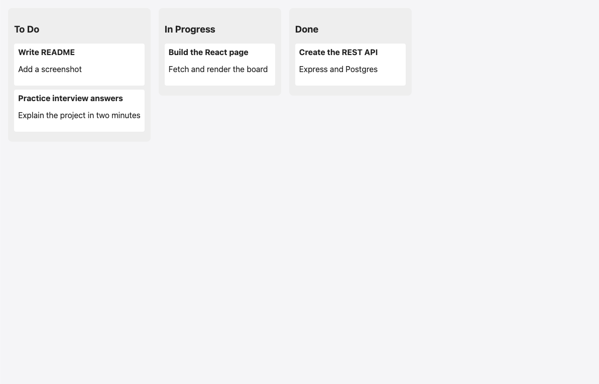

# Note Board Collab



A kanban-style board (columns and cards) built as a learning project to practice
fullstack fundamentals: a REST API with Express and PostgreSQL, a React frontend,
and real-time groundwork with Socket.IO.

Each step was built, tested, and committed incrementally, so the commit history
shows how the project grew.

## Tech stack

- **Backend:** Node.js, Express
- **Database:** PostgreSQL (raw SQL via `pg`, parameterized queries)
- **Frontend:** React (Vite)
- **Real-time:** Socket.IO (server set up, board events planned)
- **Deployment:** Docker (planned)

## Project structure

```
client/          React app (Vite)
src/
  routes/        columns.js, cards.js, board.js
  app.js         Express setup (CORS, JSON parsing, routes)
  server.js      HTTP server with Socket.IO attached
  db.js          PostgreSQL connection pool
db/schema.sql    Tables and seed columns
docs/            Screenshots
```

## Progress

- [x] REST API with Express: validation, proper status codes, parameterized queries
- [x] PostgreSQL schema: columns and cards with a foreign key and cascade delete
- [x] Data model reframed from notes to columns + cards
- [x] `GET /board` returns every column with its cards in one response
- [x] Socket.IO server set up and accepting connections
- [x] React client that renders the board from the API
- [ ] Add and delete cards from the UI (in progress)
- [ ] Real-time board updates (broadcast card and column events to clients)
- [ ] Drag and drop between columns (needs position renumbering)
- [ ] Docker
- [ ] Authentication
- [ ] Deployment

## Running locally

Requirements: Node.js and PostgreSQL.

```bash
# 1. Install server dependencies
npm install

# 2. Create the database and tables
createdb noteboard
psql noteboard -f db/schema.sql

# 3. Start the API (auto-restarts on changes)
npx nodemon src/server.js
```

The API runs on `http://localhost:3000`. The connection settings are in
`src/db.js`; set the `user` there to match your local PostgreSQL user.

In a second terminal, start the React app:

```bash
cd client
npm install
npm run dev
```

The app runs on `http://localhost:5173`.

## API endpoints

| Method | Endpoint       | Description                                        |
|--------|----------------|----------------------------------------------------|
| GET    | `/board`       | All columns, each with its cards                   |
| GET    | `/columns`     | List columns                                       |
| POST   | `/columns`     | Create a column (`name`; position set by server)   |
| PUT    | `/columns/:id` | Rename a column                                    |
| DELETE | `/columns/:id` | Delete a column and its cards                      |
| GET    | `/cards`       | List cards                                         |
| GET    | `/cards/:id`   | Get one card                                       |
| POST   | `/cards`       | Create a card (`column_id`, `title`, `content`)    |
| PUT    | `/cards/:id`   | Update a card's title and content                  |
| DELETE | `/cards/:id`   | Delete a card                                      |

## Known limitations and next steps

- No authentication; anyone who can reach the API can change the board.
- Database connection settings are hardcoded in `src/db.js` (planned: environment variables).
- Cards cannot be moved between columns yet, and positions are not renumbered after deletes.
- Socket.IO connections work, but the board routes do not broadcast events yet.
- No automated tests.